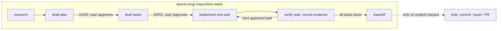

# 0001. Staged spec-driven workflow with human approval gates

**Status**: Proposed
**Date**: 2026-10-11
**Related**: `README.md`, `skills/loopcraft/SKILL.md`

## Context

- Coding agents (Claude Code, Codex, Pi) can go from a request to code changes in a single autonomous pass, which makes it hard for a human to review intent before code exists and to resume work reliably across sessions.
- Loopcraft exists to give those agents a repeatable loop for repository changes: `research → plan approval → task approval → implement → verify → handoff/ship` (README, "Use it").
- The main skill (`skills/loopcraft/SKILL.md`, "Gates") requires the agent to stop after a draft plan and again after draft tasks until the user explicitly approves, to implement only approved tasks one at a time, and to run each task's verification before marking it done.
- Work state is persisted in the repository, not in chat: `specs/<id>-slug/` holds `research.md`, `plan.md`, `tasks.md`, and optional `handoff.md`. The skill instructs: "Keep approvals and verification evidence in those files, not only in chat."
- Token cost is a stated concern: commit `c5ca7e1` ("few more changes to save token for skills") and the skill layout load only the current phase's reference file on demand instead of one monolithic instruction set.
- The workflow itself supplies no project-specific commands; each repository provides its own conventions via `AGENTS.md`/`CLAUDE.md` (README, "Project artifacts").

## Options considered

1. **Single autonomous pass, no gates**: fewest interactions; no chance to correct a wrong goal or plan before code is written, and nothing durable to resume from. *(Inferred: the gate-centric design rejects this default agent behavior.)*
2. **A separate skill per phase** (start, research, plan, tasks, implement, verify, resume, handoff): each phase isolated and small; eight skills to discover, invoke, and keep consistent. The README states the single `loopcraft` skill "replaces separate start, research, plan, tasks, implement, verify, resume, and handoff skills."
3. **One monolithic skill containing all phase instructions**: a single file to install; every invocation pays the full token cost regardless of phase. *(Inferred from the token-saving commit and the load-on-demand `references/` layout.)*
4. **Keep approvals and evidence in chat only**: zero files to maintain; state is lost between sessions and cannot be reviewed in the repository. Explicitly rejected by the SKILL.md instruction to keep approvals and verification evidence in `specs/` files, "not only in chat."

## Decision

Adopt one staged workflow skill (`loopcraft`) that drives every repository change through research, plan, tasks, implementation, and verification, pausing at explicit human-approval gates (draft plan, draft tasks) and persisting all state, approvals, and verification evidence under `specs/<id>-slug/` in the repository. Phase instructions live in separate reference files loaded only for the current phase; ADR writing (`loopcraft-adr`) and shipping (`loopcraft-ship`) stay separate skills invoked only on request.

Every stage writes its artifact (`research.md`, `plan.md`, `tasks.md`, `handoff.md`) into `specs/<id>-slug/`; the two solid-edge gates are the only points that block on human approval, and shipping never happens without an explicit request.

## Consequences

- Good: intent is reviewed twice (plan, tasks) before code changes; approvals and verification evidence survive sessions and are reviewable in the repo; one task is implemented and verified before the next begins; the same workflow runs on Claude Code, Codex, and Pi because state is plain files; token use stays proportional to the current phase.
- Bad: every change costs at least two extra human interactions (plan approval, task approval) before implementation; the `specs/` files must be kept current — a stale approval record misleads later sessions; gates are instructions to the agent with no hard enforcement, so an agent that ignores the skill bypasses them; per-task verification depends on the repository providing runnable checks, which the workflow does not supply.
